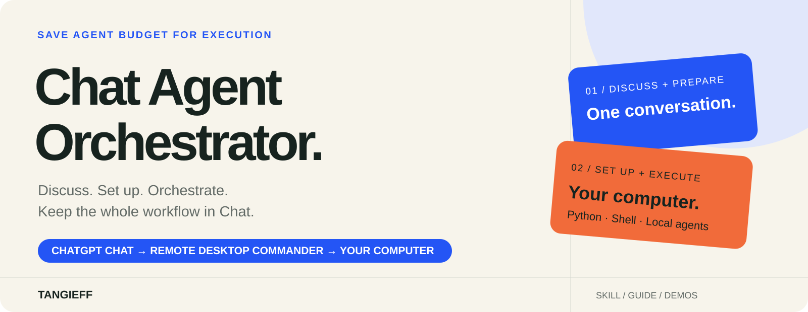
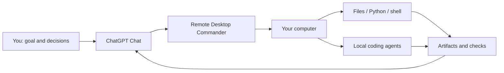
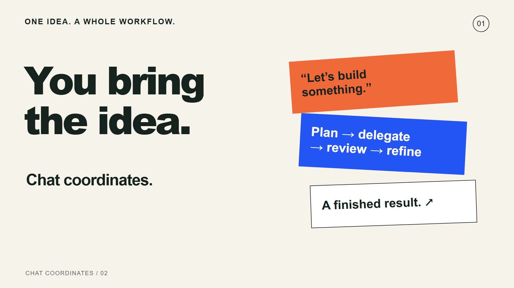

<p align="center"></p>

<p align="center"><strong>Discuss. Set up. Orchestrate. All from Chat.</strong><br>By <a href="https://github.com/Tangieff">Tangieff</a></p>

<p align="center"><a href="skills/chat-agent-orchestrator/references/remote-setup.md">Start here: full setup guide</a> · <a href="skills/chat-agent-orchestrator/references/prompts.md">Copy the prompts</a> · <a href="docs/install-skill.md">Use the skill</a> · <a href="#see-it-in-action">See it in action</a></p>

**Save coding-agent limits on project preparation and orchestration.** Keep the discussion, planning, project structure, environment setup, and launch control in ordinary **ChatGPT Chat**. Through **Remote Desktop Commander**, Chat can act on your computer: create folders and files, run Python or shell commands, launch local tools, start coding agents, inspect their work, and return a checked result.

Give Chat the goal and discuss the decisions. It turns that conversation into an organized project and runs the workflow for you. You do not need to keep opening terminals, moving prompts between applications, or supervising every handoff yourself.

**Use a coding agent where it adds value.** Preparation and coordination can happen through Chat and direct computer tools without sending those stages to Claude Code or Codex. For suitable tasks, Chat can also produce the result directly with Python, shell commands, or file operations. For a larger implementation, it gives the chosen agent a focused brief and keeps review and follow-up in the same conversation.

## Start here

| You want to… | Open this |
| --- | --- |
| Connect ChatGPT Chat to your computer | [Complete Remote Desktop Commander setup](skills/chat-agent-orchestrator/references/remote-setup.md) |
| Understand which stages stay in Chat | [The project workflow](docs/workflow.md) |
| Give Chat a complete project brief | [Ready-to-use prompts](skills/chat-agent-orchestrator/references/prompts.md) |
| Reuse this behavior for every project | [Skill installation and Chat usage](docs/install-skill.md) |
| See a completed orchestration run | [Focus Kit walkthrough](docs/demos.md) |

## Keep the whole workflow in one conversation

| Stage | What Chat handles |
| --- | --- |
| **Discuss** | Clarify the idea, audience, constraints, and definition of done. |
| **Prepare** | Turn the discussion into a brief, stages, and a sensible project layout. |
| **Set up** | Create the structure, prepare task files, inspect the environment, and run the required setup. |
| **Execute** | Run suitable Python or shell work directly; launch Claude Code, Codex, or another local tool for the stages that need it. |
| **Coordinate** | Track the actual run, inspect results, send focused feedback, and continue the next stage. |
| **Deliver** | Verify the important behavior and return the artifact, preview, and a concise result. |

The saving comes from moving the surrounding work into Chat: a coding agent receives the implementation it needs to do, instead of the entire discussion and repeated setup instructions. This workflow does not require a coding-agent call for every stage.



Chat launches processes through the connected computer tools. Interactive control inside a desktop application uses an available computer-control tool when the task needs it. The [workflow guide](docs/workflow.md) explains how to choose the execution route.

## See it in action

[](videos/chat-coordinates.mp4)

**45 seconds: discuss → plan → delegate → review → refine → working result.** Chat coordinates a Focus Kit launch page, gives Claude a bounded implementation brief, reviews the real files, and directs a second pass.

[Watch / download the video](https://github.com/Tangieff/chat-agent-orchestrator/raw/refs/heads/main/videos/chat-coordinates.mp4) · [Follow the walkthrough](docs/demos.md) · [Compare the first and final versions](examples/focus-kit)

The video is a condensed demonstration of a completed run. Screenshots and audio are supporting demo assets.

## Give Chat the project

After connecting your computer, paste this into Chat:

> Use Remote Desktop Commander to run this project on my connected computer. Discuss the goal and success criteria with me, turn them into stages, and prepare the project structure directly. Keep discussion, setup, launch control, and review here in Chat. Use Python, shell commands, or direct file operations for suitable work. Launch my available local coding agent only for implementation stages that need it. Track the actual run, inspect the result, handle focused refinements, and return a verified artifact or local preview. Keep changes inside the agreed project folder.

The [prompt pack](skills/chat-agent-orchestrator/references/prompts.md) includes the Focus Kit example and a Python-only task. The [reusable skill](skills/chat-agent-orchestrator/SKILL.md) makes this workflow easier to repeat.

## What's included

```text
skills/chat-agent-orchestrator/  Reusable orchestration skill + setup and prompts
plugin.json                     Portable skill package manifest
docs/                           Workflow, installation, demo, verification
examples/focus-kit/v1/           First implementation from the demo
examples/focus-kit/final/        Reviewed and refined implementation
videos/chat-coordinates.mp4      Completed orchestration demonstration
media/                          Supporting screenshots and audio
assets/                         Project artwork and video preview
```

## Official references

- [Remote Desktop Commander: installation and pairing](https://github.com/desktop-commander/remote-desktop-commander/blob/main/docs/SETUP.md)
- [Remote Desktop Commander: client connections](https://github.com/desktop-commander/remote-desktop-commander#quick-start)
- [OpenAI: installing plugins](https://learn.chatgpt.com/docs/plugins)
- [OpenAI: building skills](https://learn.chatgpt.com/docs/build-skills)
- [Claude Code: quickstart](https://code.claude.com/docs/en/quickstart)
- [Codex CLI: installation and sign-in](https://learn.chatgpt.com/docs/codex/cli)

Created and maintained by [Tangieff](https://github.com/Tangieff).
